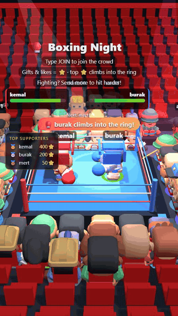
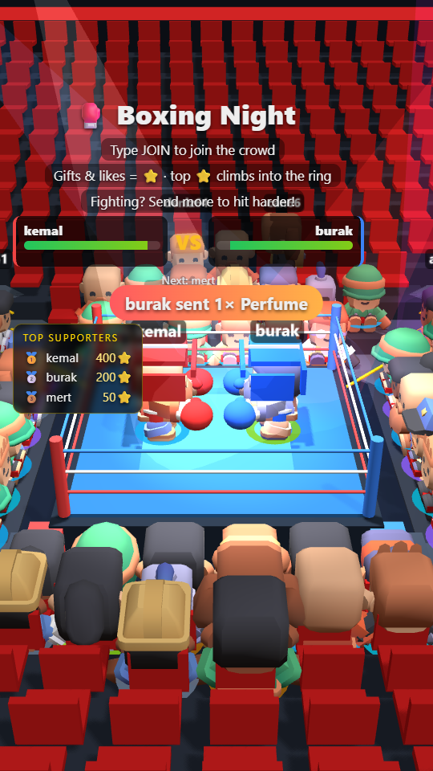
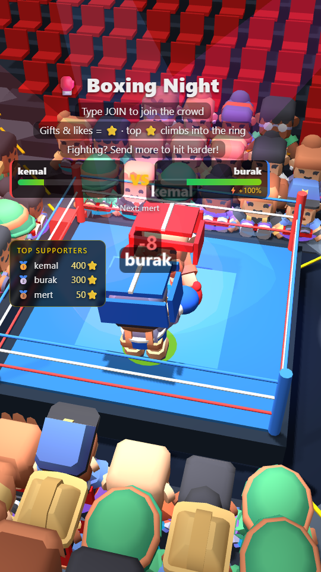
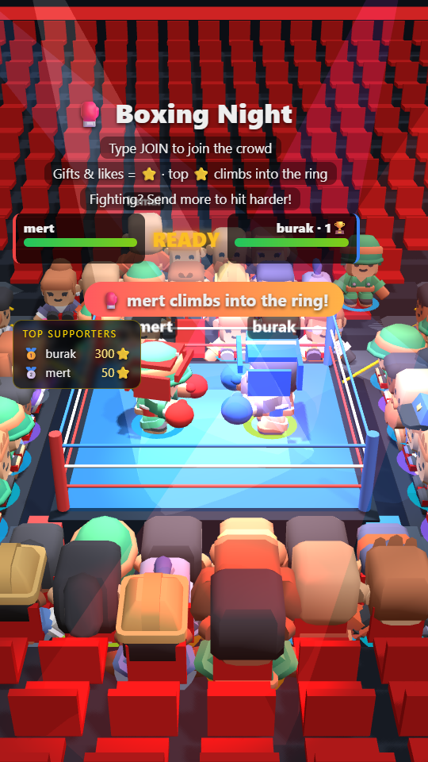
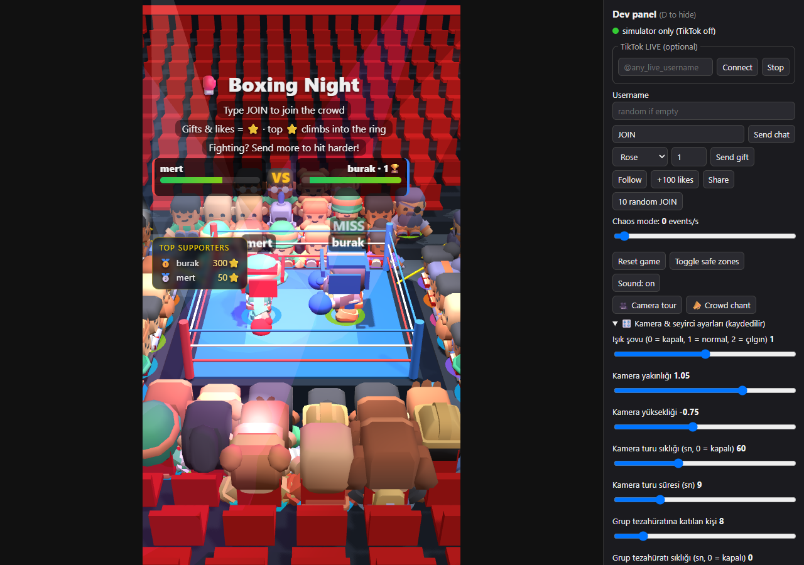

# 🥊 Boxing Night: a TikTok LIVE crowd game

**English** · [Türkçe](README.tr.md)

An interactive 3D game for TikTok LIVE streams. Viewers join the crowd by typing in chat. Gifts and likes give them points. The top two scorers climb into the ring and box. The loser goes back to the stands, the winner stays, and the next top scorer climbs in.

It runs in a browser on your PC. You capture the browser window with OBS or TikTok LIVE Studio. Everything also works **offline with a built-in simulator**, so you can try it without going live.

<p align="center">
  
</p>

<p align="center">
  <a href="docs/media/demo.mp4">▶ Watch the MP4 version</a>
</p>

| The fight | Camera flyover | Next challenger |
|---|---|---|
|  |  |  |

---

## Features

**Gameplay**
- Type `JOIN` in chat to take a seat in the arena. Each viewer gets a 3D character.
- 1 diamond = 10 ⭐ and 1 like = 1 ⭐. The top two ⭐ scorers fight: one in the red corner, one in the blue corner.
- Fighters who send gifts or likes during the fight hit harder (up to +150%) and get HP back.
- After a K.O., the loser's score goes back to 0 and the next top scorer climbs in. The winner keeps a win streak 🏆.
- On screen: HP bars, power, a "Next" queue, a leaderboard, and gift banners.

**Arena**
- A 3D boxing ring with a seated crowd on all four sides, corner stairs, LED walls, a lighting truss and a jumbotron.
- Fighters wear boxing gear: big gloves, hand wraps, trunks and headgear in their corner colour.
- Light show: photo flashes in the stands, sweeping colour spotlights, a flash on big punches, and a strobe with pyro on a K.O.
- The camera flies around the arena from time to time and zooms in on a knockout.

**Crowd and sound**
- Groups of fans jump up and shout "o-LEY!". The whole stand does a wave with an "O-LÉ, O-LÉ" chant.
- The crowd reacts to punches ("oooh!", "OHHH!", "aww"), keeps a clap-clap-HEY rhythm, and roars on a K.O.
- All sounds are generated with the Web Audio API. There are no audio files.

**Tools**
- A dev panel to send fake chat, gifts, follows and likes, plus a chaos mode (up to 200 events per second).
- Live sliders for the light show, camera zoom and height, how often the camera tours, and crowd chant size and frequency. Changes reach every open screen (OBS too) and are saved to the theme file.
- An optional live TikTok connection (read-only) through [`tiktok-live-connector`](https://github.com/zerodytrash/TikTok-Live-Connector).
- A second theme, a street parade (`"theme": "default"`).



---

## Quick start

You need [Node.js](https://nodejs.org) 18 or newer.

```bash
git clone https://github.com/FikretGezer/tiktok-live-boxing-game.git
cd tiktok-live-boxing-game
npm install
npm start
```

Open http://localhost:8080. On Windows you can double-click `Start.bat` instead.

- The **dev panel** is on the right. Press **D** to hide it.
- For a clean capture view in OBS, open http://localhost:8080/?capture=1 (portrait 1080×1920).
- Click the page once to turn on sound. Browsers start audio only after a click.
- To run the tests: `npm test`

## Connect to a TikTok LIVE (optional)

1. Type a username that is live right now in the dev panel, then press **Connect**.
2. Or set `"source": "tiktok"` and `tiktok.username` in `config.json`.

The connection is read-only. It uses an unofficial library and a signing service (Euler Stream). It can break when TikTok changes things. The simulator always keeps working.

> TikTok has its own rules for LIVE content, gifts and games. Check them before you use this on a real stream.

## Configuration

| File | What it controls |
|---|---|
| `config.json` | Port, event source, active theme, TikTok username, limits (max avatars, spawns per second, cooldowns), blocklist |
| `themes/ring.json` | Boxing rules (points, damage, miss chance, heal), HUD text, camera, crowd chants, light show |
| `themes/default.json` | The parade theme |

## How it works

```
TikTok LIVE ─┐
             ├─► normalize ─► game rules (server/game.js, server/ring.js) ─► WebSocket ─► browser (Three.js)
Simulator ───┘
```

- **Server:** Node.js with `ws`. It serves the client and runs the game rules.
- **Client:** Three.js, loaded from a CDN. Characters are animated GLB models.
- Events are logged to `events.log` (not committed).

```
server/   index.js · game.js · ring.js · normalize.js · sources/ (simulator, tiktok)
client/   index.html · main.js · sound.js · style.css · assets/models/
themes/   ring.json · default.json
docs/     DEVLOG.tr.md (development log, in Turkish) · media/
```

## Credits

- 3D characters: [Kenney Mini Characters](https://kenney.nl) (CC0). See `client/assets/models/LICENSE-kenney.txt`.
- 3D engine: [Three.js](https://threejs.org).
- TikTok connection: [TikTok-Live-Connector](https://github.com/zerodytrash/TikTok-Live-Connector).

## License

Code: [MIT](LICENSE). The 3D characters are CC0 (Kenney).

This is a fan project. It is not affiliated with TikTok.
