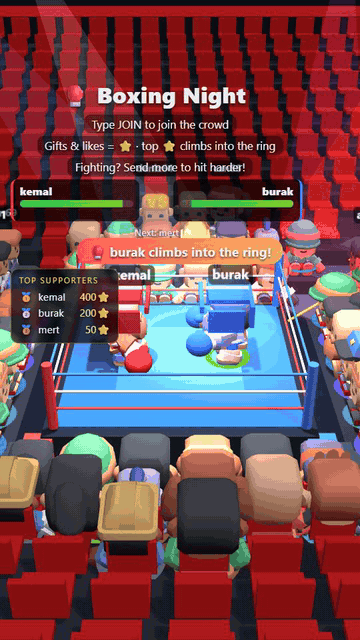
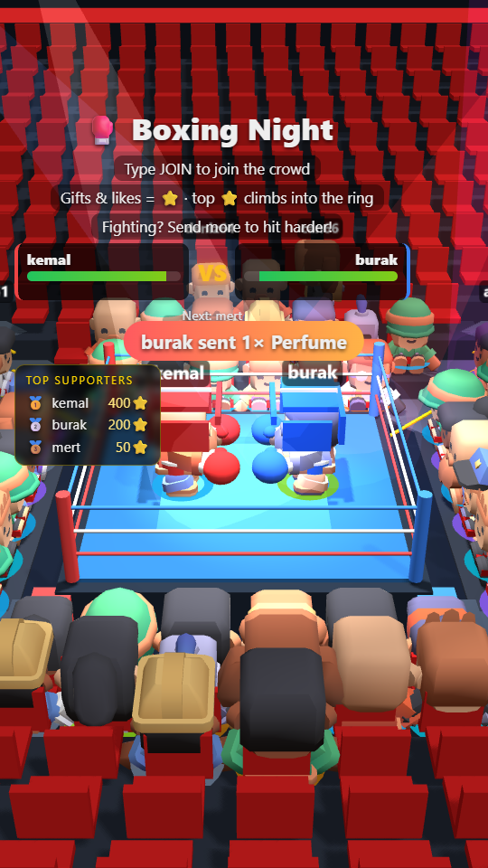
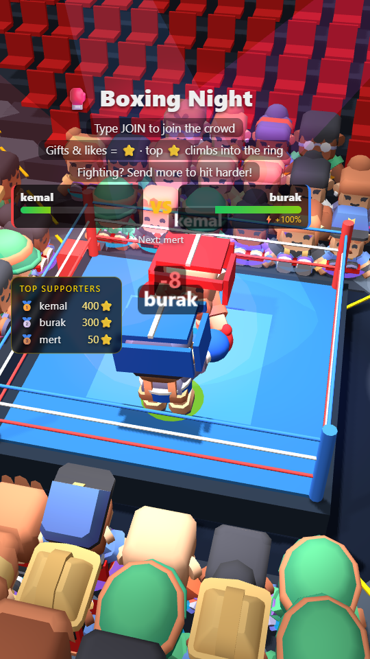
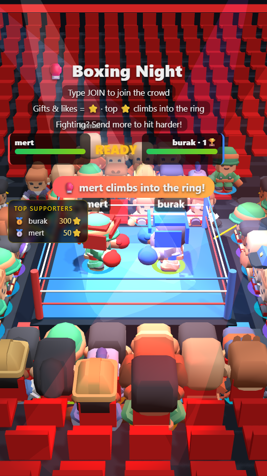
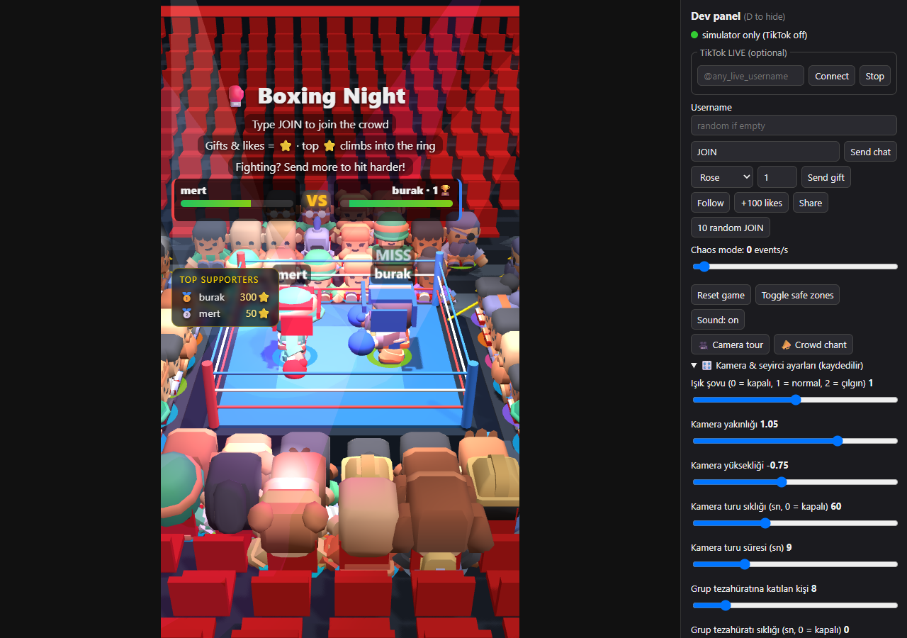

# 🥊 Boxing Night: TikTok LIVE kalabalık oyunu

[English](README.md) · **Türkçe**

TikTok LIVE yayınları için etkileşimli bir 3D oyun. İzleyiciler chat'e yazarak kalabalığa katılır. Hediye ve beğeniler puan kazandırır. En çok puanı olan iki kişi ringe çıkıp boks yapar. Kaybeden tribüne döner, kazanan ringde kalır, sıradaki en yüksek puanlı kişi ringe çıkar.

Oyun bilgisayarında tarayıcıda çalışır. Tarayıcı penceresini OBS veya TikTok LIVE Studio ile yayına alırsın. Her şey **dahili simülatörle internetsiz de çalışır**, yani yayına girmeden deneyebilirsin.

<p align="center">
  
</p>

<p align="center">
  <a href="docs/media/demo.mp4">▶ MP4 olarak izle</a>
</p>

| Dövüş | Kamera turu | Sıradaki rakip |
|---|---|---|
|  |  |  |

---

## Özellikler

**Oynanış**
- Chat'e `JOIN` yazan arenada bir koltuğa oturur. Her izleyicinin bir 3D karakteri olur.
- 1 elmas = 10 ⭐, 1 beğeni = 1 ⭐. En çok ⭐'ı olan iki kişi dövüşür: biri kırmızı, biri mavi köşede.
- Dövüş sırasında hediye veya beğeni gönderen boksör daha sert vurur (en fazla +%150) ve canı artar.
- K.O.'dan sonra kaybedenin puanı sıfırlanır, sıradaki en yüksek puanlı kişi ringe çıkar. Kazananın galibiyet serisi 🏆 sayılır.
- Ekranda can barları, güç, "Next" sırası, puan tablosu ve hediye bildirimleri var.

**Arena**
- 3D boks ringi, dört tarafında oturan seyirciler, köşelerde merdivenler, LED duvarlar, ışık iskelesi ve dev ekran.
- Boksörlerde büyük eldiven, el bandajı, şort ve köşe renginde kask var.
- Işık şovu: tribünde foto flaşları, dönen renkli spotlar, sert yumrukta parlama, K.O.'da strob ve havai fişek.
- Kamera ara ara arenanın etrafında uçar, nakavtta ringe yaklaşır.

**Seyirci ve ses**
- Seyirciler gruplar halinde ayağa kalkıp "o-LEY!" diye bağırır. Bütün tribün "O-LÉ, O-LÉ" tezahüratıyla dalga yapar.
- Seyirci yumruklara tepki verir ("oooh!", "OHHH!", "aww"), "alkış alkış HEY" temposu tutar, K.O.'da coşar.
- Bütün sesler Web Audio ile üretilir. Ses dosyası yoktur.

**Araçlar**
- Sahte chat, hediye, takip ve beğeni göndermek için dev panel ve kaos modu (saniyede 200 olaya kadar).
- Işık şovu, kamera yakınlığı ve yüksekliği, kamera turu sıklığı, tezahürat kişi sayısı ve sıklığı için canlı sürgüler. Değişiklikler açık olan her ekrana (OBS dahil) gider ve tema dosyasına kaydedilir.
- İsteğe bağlı canlı TikTok bağlantısı (sadece okur), [`tiktok-live-connector`](https://github.com/zerodytrash/TikTok-Live-Connector) ile.
- İkinci bir tema: sokak geçidi (`"theme": "default"`).



---

## Hızlı başlangıç

[Node.js](https://nodejs.org) 18 veya daha yenisi gerekir.

```bash
git clone https://github.com/FikretGezer/tiktok-live-boxing-game.git
cd tiktok-live-boxing-game
npm install
npm start
```

http://localhost:8080 adresini aç. Windows'ta bunun yerine `Start.bat` dosyasına çift tıklayabilirsin.

- **Dev panel** sağda. Gizlemek için **D** tuşuna bas.
- OBS için temiz görüntü: http://localhost:8080/?capture=1 (dikey 1080×1920).
- Sesi açmak için sayfaya bir kez tıkla. Tarayıcılar sesi ancak tıklamadan sonra başlatır.
- Testleri çalıştırmak için: `npm test`

## TikTok LIVE'a bağlanma (isteğe bağlı)

1. Dev panelde şu an yayında olan bir kullanıcı adı yaz ve **Connect**'e bas.
2. Ya da `config.json` içinde `"source": "tiktok"` ve `tiktok.username` ayarla.

Bağlantı sadece okur. Resmi olmayan bir kütüphane ve bir imzalama servisi (Euler Stream) kullanır. TikTok bir şeyi değiştirince bozulabilir. Simülatör her zaman çalışır.

> TikTok'un canlı yayın içerikleri, hediyeler ve oyunlar için kendi kuralları var. Gerçek yayında kullanmadan önce kontrol et.

## Ayarlar

| Dosya | Neyi ayarlar |
|---|---|
| `config.json` | Port, olay kaynağı, aktif tema, TikTok kullanıcı adı, sınırlar (en fazla karakter, saniyede giriş, bekleme süreleri), engel listesi |
| `themes/ring.json` | Boks kuralları (puan, hasar, ıskalama şansı, can artışı), ekran yazıları, kamera, tezahürat, ışık şovu |
| `themes/default.json` | Geçit teması |

## Nasıl çalışır

```
TikTok LIVE ─┐
             ├─► normalize ─► oyun kuralları (server/game.js, server/ring.js) ─► WebSocket ─► tarayıcı (Three.js)
Simülatör ───┘
```

- **Sunucu:** Node.js ve `ws`. İstemciyi sunar ve oyun kurallarını çalıştırır.
- **İstemci:** CDN'den yüklenen Three.js. Karakterler animasyonlu GLB modeller.
- Olaylar `events.log` dosyasına yazılır (repoya eklenmez).

```
server/   index.js · game.js · ring.js · normalize.js · sources/ (simulator, tiktok)
client/   index.html · main.js · sound.js · style.css · assets/models/
themes/   ring.json · default.json
docs/     DEVLOG.tr.md (geliştirme günlüğü) · media/
```

Geliştirme günlüğü (ne yapıldı, ayarların tamamı, bilinen sorunlar): [docs/DEVLOG.tr.md](docs/DEVLOG.tr.md)

## Teşekkürler

- 3D karakterler: [Kenney Mini Characters](https://kenney.nl) (CC0). Bkz. `client/assets/models/LICENSE-kenney.txt`.
- 3D motor: [Three.js](https://threejs.org).
- TikTok bağlantısı: [TikTok-Live-Connector](https://github.com/zerodytrash/TikTok-Live-Connector).

Bu bir hayran projesidir. TikTok ile bir bağlantısı yoktur.
